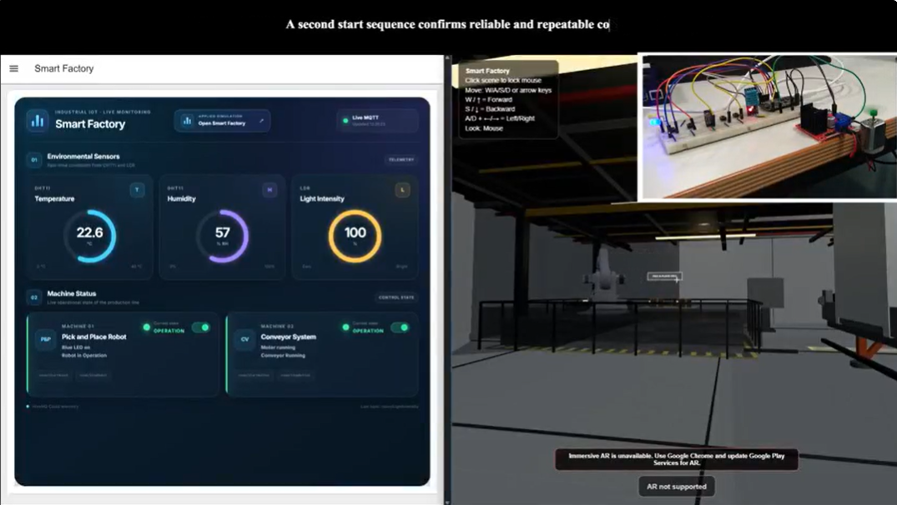

# AR Smart Factory Applied Simulation

An interactive, browser based Smart Factory with two connected rooms, a pick and place robot, a conveyor packaging line, desktop navigation, and an augmented reality mode. The project uses Three.js for the factory scene and can exchange MQTT commands and sensor data with an ESP8266 and Node-RED setup.

## Features

- Walk through the factory using keyboard and mouse controls, with collision handling and an automatic sliding door.
- Start and stop the robot and conveyor from the 3D control panels; observe motion, status indicators, and synchronized sound.
- Place the factory on a detected floor using WebXR on a supported AR device, then control the machines through four on-screen buttons.
- Connect to a private MQTT broker to synchronize browser actions with physical hardware and monitoring dashboards.

The desktop and supported AR simulation can run without MQTT. Live sensor readings and physical device control need the companion ESP8266 and Node-RED setup.

## Files

| Path | Purpose |
|---|---|
| `index.html` | Self-contained simulation with embedded GLB models and MP3 audio; about 23.6 MB. |
| `config.example.js` | Template for optional private MQTT connection settings. |
| `documentation/Smart_Factory_Documentation.ipynb` | Detailed architecture, controls, topic map, AR design, and testing notes. |
| `documentation/images/system_overview.png` | System overview image used in this README. |
| `assets/` | Original model and sound files supplied with the project. Their bytes are also embedded in the HTML. |

See [asset credits and provenance](ASSET_CREDITS.md) for the two CC BY model attributions and the three assets whose redistribution terms still need confirmation.

## Run the desktop simulation

1. Download the repository files and keep `index.html` at the root.
2. Open a terminal in that folder and run `python -m http.server 8000 --bind 127.0.0.1` (or use another static web server).
3. Open `http://localhost:8000/` in a current Chromium based browser.
4. Click in the scene to lock the mouse. Use `W/A/S/D` or arrow keys to move, move the mouse to look around, and press `Esc` to release the mouse.
5. Aim the center crosshair at the green or red machine control button and click to start or stop it.

The page loads Three.js and MQTT.js from external CDNs, so the first run requires internet access.
Without private MQTT settings, a missing `config.local.js` request is expected and the simulation still runs.

## Try augmented reality

Augmented reality (AR) lets you see the virtual factory in your real surroundings through a compatible phone or tablet camera. The factory appears to sit on your floor. As you turn or move your phone, your view of the factory changes in real time, letting you look around it from different angles.

To try it, open the simulation over HTTPS on a device and browser that support WebXR immersive AR and hit testing. Tap **Start AR**, point the camera at a clear area of floor until a green placement ring appears, then tap the ring to place the factory. Use the four on-screen buttons to start or stop the robot and conveyor. Tap **Exit AR** to leave AR mode. Availability depends on your device and browser.

**Safety:** Use AR in a large, open space away from furniture, stairs, and other obstacles. Stay aware of your real surroundings as you move around the virtual factory.

## Optional private MQTT integration

The repository copy starts with MQTT disabled. For private testing:

1. Copy `config.example.js` to `config.local.js` in the repository root.
2. Set `host` to the broker hostname (without `wss://`), and enter the broker port, path, and a dedicated, restricted account.
3. Serve the folder locally again. The HTML loads `config.local.js` before connecting to MQTT.

`config.local.js` is excluded by `.gitignore`. Do not upload it through GitHub's browser interface. Any credentials served to a browser are visible to visitors; keep the public deployment disconnected or use a purpose built, restricted public integration. The credentials in the original HTML should be rotated before the existing hosted build is shared further.

## Asset notice

This repository presents the author's Smart Factory simulation and its technical documentation. Some included models and sounds have separate creators and usage terms. Known creators and licenses are listed in [ASSET_CREDITS.md](ASSET_CREDITS.md); the source or license of three files could not be verified from the supplied archive. No ownership of third-party assets is claimed. A rights holder may open a repository issue to provide missing credit or request a correction. This notice does not grant permission to reuse or redistribute an asset whose rights are unresolved.

## Related project

The physical ESP8266 firmware, Node-RED flows, circuit design, and integrated documentation are in the companion [IIoT Smart Factory repository](https://github.com/JaredLeslie-Techie/IIoT-Smart-Factory). This repository focuses on the applied browser simulation and its WebXR interaction.

## Technical documentation

See the [Smart Factory documentation notebook](documentation/Smart_Factory_Documentation.ipynb) for the architecture, MQTT topic map, hardware relationship, interaction design, AR placement, test cases, and troubleshooting notes.

## Live web factory simulation

[Open the interactive Smart Factory simulation](https://smartfactoryiiot.netlify.app/) to explore the two-room 3D factory directly in your browser. Walk through the scene and use the factory control panels to start or stop the robot and conveyor. On a device that supports WebXR AR, select **Start AR** to place the virtual factory on a real floor.

## Integrated demonstration video

[Watch the Smart Factory project video on YouTube](https://youtu.be/29-3qCWDQm4). It shows the simulation together with the monitoring dashboard and physical prototype.

## Augmented reality demonstration video

[Watch the Smart Factory AR demonstration on YouTube Shorts](https://youtube.com/shorts/Jk8Vakwct8A). This short clip shows the factory in AR mode: as the phone turns, the view changes with it, letting you look around the virtual factory from different angles.
